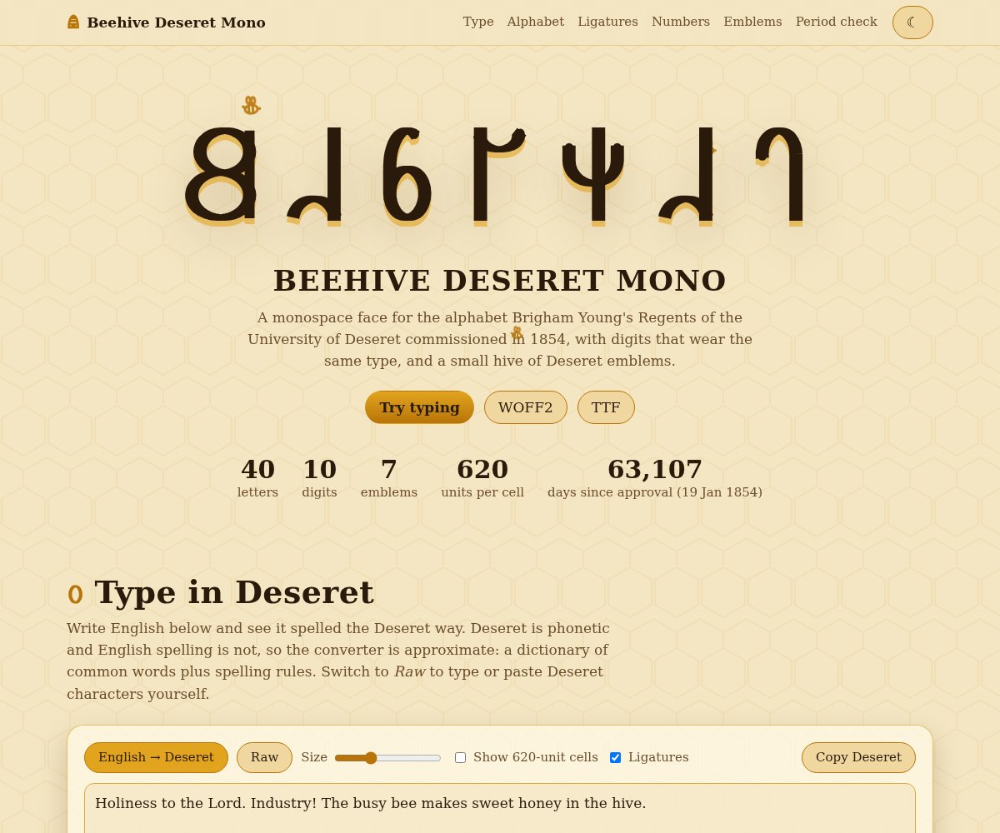

# Beehive Deseret Mono



A monospace font for the **Deseret Alphabet** (Unicode U+10400-1044F), with digits styled to match and a
small set of Deseret and LDS emblems. *Deseret* is the Book of Mormon word for honeybee, and the beehive
is the emblem of Utah.

**[Try it in the browser](https://hotschmoe.github.io/beehive-deseret/)**: type English and see it in
Deseret, browse the alphabet as a honeycomb, flip the ligatures on and off.

## Download

- [`fonts/BeehiveDeseretMono-Regular.ttf`](fonts/BeehiveDeseretMono-Regular.ttf)
- [`fonts/BeehiveDeseretMono-Regular.woff2`](fonts/BeehiveDeseretMono-Regular.woff2) for the web

```css
@font-face {
  font-family: "Beehive Deseret Mono";
  src: url("BeehiveDeseretMono-Regular.woff2") format("woff2");
}
.deseret { font-family: "Beehive Deseret Mono", monospace; }
```

## What is in it

| | |
|---|---|
| Letters | all 40 (U+10400-10427), and the lowercase block (U+10428-1044F) shares the same shapes |
| Digits | `0-9`, drawn in the Deseret style |
| Punctuation | `. , : ; - ' " ! ? ( ) /` |
| Emblems | seven glyphs in the Private Use Area (below) |
| Ligatures | Ew and Oi through `calt`, keeping the monospace grid |
| Metrics | 1000 units per em, every glyph advances 620, every letter spans exactly 0-620 in height |

## Fidelity to the originals

The alphabet was developed 1847-1854 by the University of Deseret Board of Regents under Brigham
Young (George D. Watt made the main contribution to the glyphs, with W. W. Phelps and Parley P. Pratt)
and approved 19 January 1854. Two ligatures (Oi, Ew) were added in 1859, giving 40 letters.

Design principles of the originals, which this font follows:

- One uniform letter height, no ascenders or descenders (Beehive: every letter spans exactly 0-620).
- One monoline stroke, flat-cut ends.
- No case. The Unicode lowercase block (U+10428-1044F) maps to the same shapes as the capitals.
- 40 letters, one per sound, each letter's name is its sound.

The letterforms are redrawn by hand as stroke skeletons (`skeletons.py`). Two references were used
for looking only; no outlines are copied from either:

- the 1869 Deseret Alphabet edition of the Book of Mormon (printed by Russell Bros. for the Deseret
  University; scan on [deseretalphabet.org](https://www.deseretalphabet.org/files/reading-material/)),
  including its printed alphabet chart;
- Noto Sans Deseret (OFL), via `compare.py`, for side-by-side proofs.

What the period type taught us, and what the font now does:

- Strong vertical stress: heavy verticals and thin horizontals, like the Didone-style metal type of
  the day (`CONTRAST` in `skeletons.py`; set it to 1 for a monoline version).
- Bold overall weight; round letters (Long O, Wu, rings) nearly as wide as tall.
- Every letter spans the same height (0-620); there is no case.

Also done from the period type: small ball terminals on free curved stroke ends (Long I/E, Chee, Jee,
Zee, Zhee, Er, El, Em, Ay, Yee, Es, Short O), heavier straight bars than curved hairlines (`BAR`), and
every letter and digit normalised to exactly the same height. `period_proof.py` cuts the 37 letters
printed in the chart and places Beehive beside each for checking.

Spacing: letters in the 1869 text are about 0.75-0.95 of their height wide with gaps of roughly
0.15-0.2 of the height; the 620-unit cell (1.0 x height) holds the widest letter (526) with at least
47 units clear on each side. Automatic measurement on running text is noisy because letters touch.

Each letter is also matched to the width-to-height proportion printed in the 1869 chart, and the build
solves the skeleton width to hit it (see "Checking against the chart" below). Mean overlap with the
printed letters is about 0.65; Yee, Es, Long A, Bee and Dee are the least faithful. Letterpress edge
irregularity is not reproduced.

## Ligatures

The 1859 *Deseret News* approved two ligature letters. The `calt` feature applies them, keeping the
monospace grid (the first cell is blanked and the letter is drawn across both cells):

| Sequence | Becomes |
|----------|---------|
| Short I + Long OO (U+1042E U+1042D) | Ew |
| Yee + Long OO (U+10437 U+1042D) | Ew |
| Short AH + Short I (U+10431 U+1042E) | Oi |

Works for capital or lowercase code points. Turn off with `font-feature-settings: "calt" 0`.

## Symbols (Private Use Area)

| Code | Glyph |
|------|-------|
| U+E000 | Beehive (skep) |
| U+E001 | Honeybee |
| U+E002 | Sego lily (Utah state flower) |
| U+E003 | Temple (three-spire silhouette) |
| U+E004 | All-seeing eye (as on the 1860 Deseret coinage) |
| U+E005 | Sunstone (Nauvoo) |
| U+E006 | Trumpet (Moroni) |

## Digits and punctuation

`0-9` are drawn in the same monoline style and at the same height as the letters
(`0` and `8` are rounded rectangles so they never read as Long O / Ow).
Also `. , : ; - ' " ! ? ( ) /`.

## Build

    pip install fonttools brotli skia-pathops pillow numpy
    python3 build.py        # -> fonts/BeehiveDeseretMono-Regular.{ttf,woff2}
    python3 preview.py      # -> specimen.png
    python3 compare.py REF.ttf cmp.png          # vs any reference Deseret font
    python3 period_proof.py bom.pdf proof.png   # vs the printed 1869 chart (needs pymupdf)

Pipeline: skeleton polylines -> stroked polygons (flat ends, mitred joins) -> overlap union
(skia-pathops) -> Schneider cubic Bézier fitting (`curvefit.py`) -> quadratic TrueType curves.

## Status

v0.5. No hinting; kerning is moot in a monospace font. Contributions and letter-by-letter corrections
are welcome.

## Licence

- The font files (`fonts/`, `docs/fonts/`) are under the [SIL Open Font License 1.1](OFL.txt). Use them
  freely, embed them, modify them; just do not sell the font by itself.
- The source code (build scripts, `docs/index.html`) is under the [MIT licence](LICENSE).
- The comparison sheet `docs/img/chart-vs-beehive.jpg` includes small crops of a public-domain 1869 printing.

## Demo site

`docs/index.html` is a static page, published with GitHub Pages at
<https://hotschmoe.github.io/beehive-deseret/>. It has live English-to-Deseret typing (approximate:
a dictionary plus spelling rules), a clickable honeycomb alphabet, the ligature switch, digits with a
live clock, the emblems and the 1869 comparison sheet. Run it locally with

    ./serve.sh 8420

`build.py` copies the built font into `docs/fonts/`.

## Checking against the chart

`period_overlay.py bom.pdf OUTDIR` writes large sheets with each 1869 letter, Beehive, and an overlay (chart red, Beehive blue), and prints per-letter aspect ratio, overlap (IoU) and ink ratio. The printed width/height of each letter is in `skeletons.ASPECT`; `build.py` solves the horizontal skeleton scale so every letter hits that proportion while keeping stroke weight.
